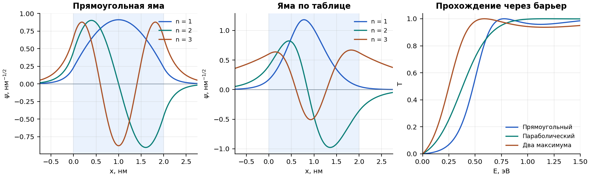

# Связанные состояния и туннелирование в одном измерении

## Цель работы

Мы хотим узнать, какие энергии может иметь частица в потенциальной яме и с какой вероятностью она проходит через барьер. Мы меняем форму потенциала и смотрим, как меняется результат.

## Физическая модель

Мы используем стационарное уравнение Шрёдингера.

> −Aψ″(x) + U(x)ψ(x) = Eψ(x), где A = ℏ²/(2m).

Мы задаём энергию в эВ, координату в нм и массу в единицах mₑ. При m = mₑ коэффициент A равен 0,0380998212 эВ·нм². Вне ямы или барьера потенциал равен нулю.

В яме мы ищем связанные состояния с E < 0. Их волновые функции затухают слева и справа от ямы. Для барьера мы берём частицу с E > 0. Волна падает слева, часть волны отражается, а справа остаётся только прошедшая волна. Волновые числа по обе стороны барьера одинаковы, поэтому R = ∣r∣² и T = ∣t∣².

Мы можем выбрать готовую форму, ввести формулу U(x) или задать точки в таблице. Между точками мы соединяем значения U прямыми линиями. Ширина меняется от 0,25 до 5 нм, а глубина ямы или высота барьера для готовых форм — от 0,01 до 5 эВ.

## Как мы считаем

### Потенциальная яма

1. Мы начинаем с 512 равных отрезков и заменяем вторую производную ψ″ центральной разностью. Для готового профиля или формулы на двух краях берём половину значения U, чтобы учесть скачок к нулю. Для таблицы мы точно усредняем линейный профиль по ячейке каждого узла, включая края. Так узкий участок влияет на расчёт, даже если он лежит между узлами. Мы увеличиваем число отрезков, чтобы на самом коротком наклонном участке помещались хотя бы четыре шага. При пределе в 8192 отрезка программа предупреждает, если шагов всё ещё мало.
2. Снаружи ямы волна затухает. Если шаг сетки равен Δx, то s = A/(Δx)². При движении от края наружу амплитуда на каждом следующем узле умножается на ρ = exp(−2 arsinh(√(−E/(4s)))). Поэтому мы можем учесть обе внешние области, добавив −sρ к двум крайним элементам диагонали матрицы.
3. Мы раскладываем трёхдиагональную матрицу и считаем отрицательные опорные элементы. Это показывает, сколько уровней лежит ниже пробной энергии E. Затем уточняем каждый уровень методом деления пополам, находим волновую функцию обратной итерацией и нормируем её с учётом обоих хвостов.

### Потенциальный барьер

Для гладкого барьера мы делим область на 280 отрезков и берём потенциал в середине каждого отрезка. Если потенциал задан таблицей, мы также ставим границы отрезков в её узлах. Для прямоугольного барьера хватает одного слоя.

На каждом слое мы точно решаем уравнение с постоянным потенциалом. При E = U волновая функция на слое линейная. Затем мы соединяем слои через коэффициенты отражения и прохождения. Мы используем масштабирование и храним ln T, чтобы считать даже очень малые вероятности.

## Результаты

Слева мы показываем первые три волновые функции для прямоугольной ямы глубиной 1 эВ и шириной 2 нм. Для среднего графика мы задали яму тремя точками. При x = 0 и x = 2 нм потенциал равен −0,1 эВ, а при x = 0,7 нм он равен −1 эВ. Справа мы сравниваем T(E) для барьеров шириной 1 нм и высотой 0,4 эВ. Во всех примерах m = mₑ.

## Как мы проверили результат

### Яма

Для прямоугольной ямы глубиной D = 1 эВ мы нашли эталонные энергии из уравнения qa + 2 arctan(q/κ) = nπ. Здесь q = √((E + D)/A), а κ = √(−E/A). Затем мы сравнили эти энергии с расчётом на двух сетках.

| n   | Аналитический E, эВ | 512 отрезков | 1024 отрезка |
| --- | ------------------: | -----------: | -----------: |
| 1   |        −0,934432110 | −0,934431199 | −0,934431882 |
| 2   |        −0,740938776 | −0,740937050 | −0,740938344 |
| 3   |        −0,432529655 | −0,432532319 | −0,432530321 |
| 4   |        −0,061528432 | −0,061542336 | −0,061531908 |

Когда мы увеличили число отрезков с 512 до 1024, ошибка стала примерно в четыре раза меньше. На сетке из 512 отрезков максимальная ошибка составила около 1,4 × 10⁻⁵ эВ. У первой волновой функции нет внутренних узлов, а у следующих трёх их один, два и три.

Мы также проверили узкую треугольную яму внутри отрезка длиной 1 нм при m = mₑ. Потенциал равен −80 эВ в точке x = 0,5004 нм и поднимается до нуля при x = 0,5002 нм и x = 0,5006 нм. Вне треугольника U = 0. На сетке из 8192 отрезков мы нашли одно состояние с E ≈ −0,001679732 эВ. Отдельно мы проверили его методом стрельбы. Проинтегрировали уравнение на двух наклонных участках и сшили решение с затухающими хвостами. Разница между двумя результатами меньше 3 × 10⁻¹⁰ эВ.

### Барьер

Для прямоугольного барьера высотой U и шириной h мы сравнили расчёт с формулой T = [1 + U²F²/(4E∣E − U∣)]⁻¹.

- При E < U берём F = sinh(h√((U − E)/A)).
- При E > U берём F = sin(h√((E − U)/A)).
- При E = U используем предел T = [1 + Uh²/(4A)]⁻¹.

| E, эВ | Режим | T, аналитика и расчёт |
| ----: | ----- | --------------------: |
|  0,04 | E < U |           0,003082655 |
|  0,40 | E = U |           0,275886101 |
|  1,00 | E > U |           0,965167108 |

Во всех трёх точках разница с формулой и величина ∣R + T − 1∣ были меньше 10⁻¹². Мы также проверили гладкий барьер U(x) = 0,4[0,1 + 4(x/h)(1 − x/h)] при h = 1 нм. Когда мы увеличили число отрезков с 280 до 560, T изменилось менее чем на 4 × 10⁻⁶ при энергиях 0,15, 0,4 и 0,8 эВ.

Мы проверили предел T → 1 для прямоугольного барьера высотой 0,4 эВ и шириной 1 нм при m = mₑ.

| E, эВ | T из расчёта |
| ---: | ---: |
| 1 | 0,965167108 |
| 10 | 0,999988679 |
| 100 | 0,999997679 |

Также мы взяли E = 0,1 эВ и увеличили ширину. При h = 1, 2 и 3 нм мы получили ln T ≈ −4,5172, −10,1257 и −15,7378. Между 2 и 3 нм наклон равен примерно −5,6121 нм⁻¹. Это совпадает с пределом −2√((U − E)/A) ≈ −5,6121 нм⁻¹ для широкого барьера.

## Вывод

Когда мы меняем форму ямы, меняются энергии связанных состояний и вид волновых функций. Частица может пройти через барьер даже при E < U. Если у профиля есть узкие детали, для точного расчёта мы берём более мелкую сетку. Значение T для выбранной энергии программа считает отдельно, поэтому оно доступно и между точками графика.
